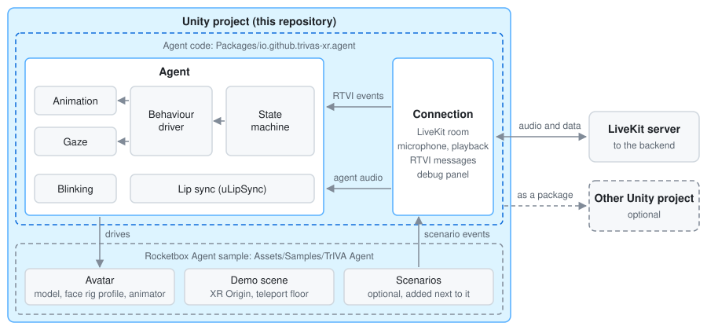

# TrIVA-Unity

**An Intelligent Virtual Agent (IVA) pipeline built for developing and studying trustworthy IVAs in XR.**

Unity XR client of TrIVA, an embodied AI agent in VR/AR. LiveKit carries audio and data between this client and the Python backend in [TrIVA-Backend](https://github.com/TrIVAs/TrIVA-Backend); the agent's speech drives lip sync, blinking and gaze on a humanoid avatar.

This repository is a complete Unity project: clone it, open it, import the Rocketbox Agent sample and press Play.



## Requirements

- **Unity 6000.3 LTS** (the project is saved with 6000.3.28f1) or newer, installed through Unity Hub, with URP, XR Interaction Toolkit 3.7.0 and OpenXR (all already set up in this project). The TrIVA Agent package also works in newer Unity 6 versions such as 6000.7.
- **Git**. The LiveKit Unity SDK and uLipSync are pulled from Git repositories when the project opens.
- **A PC VR headset** on an OpenXR runtime, such as Meta Quest Link or SteamVR, and a microphone.
- **The backend**, [TrIVA-Backend](https://github.com/TrIVAs/TrIVA-Backend), which serves LiveKit tokens and runs the agent. The token endpoint is set in `Packages/com.trivas.agent/Runtime/Config/TokenSourceConfig.asset` (default `http://localhost:8080/getToken`).

## Getting started

1. Clone this repository and open the folder in Unity Hub. The first import resolves the Git packages and takes a while.
2. Open **Window > Package Manager**, select **TrIVA Agent** under *In Project*, open its **Samples** tab and import **Rocketbox Agent**. This copies the sample to `Assets/Samples/TrIVA Agent/`.
3. Start the backend with the `chat` scenario. Its `lab` scenario greets and chats, but its task runs on game snapshots, which the demo does not send.

   ```powershell
   uv run python -m agent.run --scenario chat
   ```

4. Open `Assets/Samples/TrIVA Agent/<version>/Rocketbox Agent/Rocketbox Agent Demo.unity` and press Play.

The demo scene has an XR Origin with a teleportable floor, the Rocketbox avatar Female_Adult_01 (MIT) as the agent, the LiveKit connection and a world-space debug panel. The imported sample belongs to the project and can be changed freely: the avatar swapped, objects added, further scenes and scenarios built next to it. A scenario is a task participants solve together with the agent; it tells the agent what the participant does by sending RTVI client messages.

More free avatars are available in the [Microsoft Rocketbox](https://github.com/microsoft/Microsoft-Rocketbox) repository (MIT), with the same skeleton and blendshape naming as the sample avatar. Lip sync, blinking and gaze need the variants with facial blendshapes (`_facial`).

## Where the files are

Unity projects keep their own files in `Assets/`, but they can also hold code in `Packages/`. This project does both. In the Project window, the agent code appears under **Packages > TrIVA Agent**, not under Assets, and opens and edits there like any other file.

| Path | Contents |
|---|---|
| `Packages/com.trivas.agent/` | The agent code, shared by every scene and project that uses the agent |
| `Assets/Samples/TrIVA Agent/` | The imported Rocketbox Agent sample: avatar, materials, animations, animator and demo scene |
| `Assets/Scenes/LiveKitConnectionTest.unity` | Minimal scene that only connects to LiveKit, for testing the backend |
| `Assets/Samples/XR Interaction Toolkit/`, `Assets/Samples/XR Hands/` | Samples of those packages; Starter Assets and World Space UI are used by the demo scene and the debug panel |

The agent code inside `Packages/com.trivas.agent/`:

| Folder | Contents |
|---|---|
| `Runtime/Connection/` | LiveKit connection with retry, agent audio playback, microphone publishing with push-to-talk and mute, the RTVI message channel |
| `Runtime/Agent/` | Agent state machine, behaviour driver (animation and gaze), blinking, lip sync binding, face rig profile, random animation variants |
| `Runtime/Debugging/` | World-space debug panel and an Editor-only recorder for RTVI messages |
| `Runtime/UI/` | Layout, theme and fonts of the debug panel |
| `Runtime/Utils/` | Inspector button attribute and a singleton base class |
| `Runtime/Prefabs/` | `LiveKitConnector` and `DebugLogUI` prefabs |
| `Runtime/Config/` | The token endpoint |
| `Runtime/Scenes/` | Additive scene loading |
| `Editor/` | Inspector buttons and the additive scene opener |
| `Tests/` | PlayMode tests against a fake RTVI backend |
| `Samples~/` | Source of the Rocketbox Agent sample; hidden from Unity until imported |

## LiveKit fork

LiveKit is pinned in `Packages/manifest.json` to [a fork](https://github.com/MirCore/client-sdk-unity) with a fix for entering Play mode without a domain reload ([livekit/client-sdk-unity#396](https://github.com/livekit/client-sdk-unity/pull/396)), until that fix is merged upstream.

## Using the agent in another Unity project

Optional, for adding the agent to an existing project instead of working in this one. Add the LiveKit Unity SDK and uLipSync Git packages from this project's `Packages/manifest.json` to that project's manifest (Unity packages cannot declare Git dependencies themselves), then the agent package, either as a local path (`"file:<path to>/Packages/com.trivas.agent"`) or as a Git URL with `?path=/Packages/com.trivas.agent`. Import the XR Interaction Toolkit samples **Starter Assets** and **World Space UI** there too.